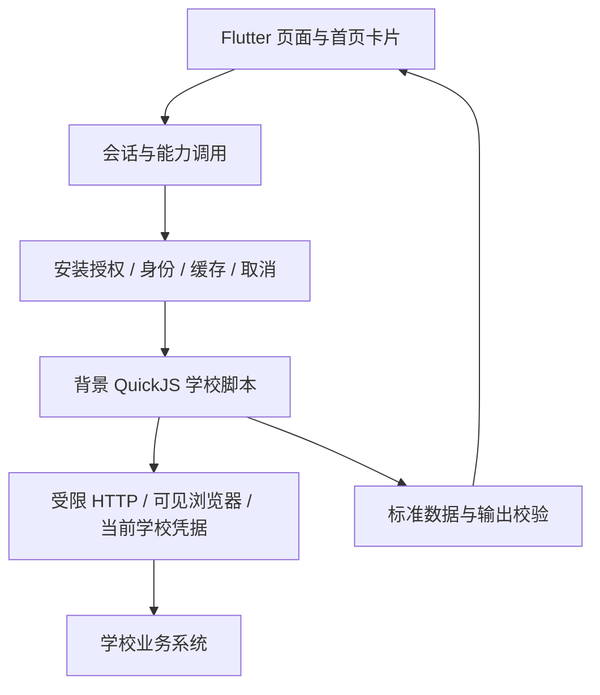

# Elecon 当前架构

当前主线是**受信学校脚本、宿主能力边界、标准业务数据和客户端页面**。学校变化集中在脚本，跨学校可复用的业务含义留在契约。决策基线见 [ADR-041](adr/adr_041_current_architecture.md)，开发入口见 [AGENTS](../AGENTS.md)。

## 已有实现

`school-scripts/` 是新学校源码；`adapters/_template/trusted/` 是现有源码模板。`contract/script-package.schema.json` 和 `contract/script-sdk/` 定义包与宿主 API；`contract/schema/` 定义数据，不能用模板名替代领域语义。客户端注册表当前按倒序安装顺序选提供者，尚没有正式增强包关系或显式 provider 绑定。

脚本可见本校授权凭据。SDK 2 namespace 只避免存储键冲突，同校共享是显式寻址，不是隔离权限。客户端保管主密钥、安装授权与执行代际；脚本不得读取其他学校身份或任意原生能力。输出 schema 校验不等于能识别任意秘密的防泄漏过滤。

公网 `server/src/public` 目前提供签名产物静态分发；`server/src/campus` 仍返回 501。新源码脚本没有生产服务端执行器。现有 V1 official/Broker/Masker 路径按[兼容边界](reference/legacy_compatibility.md)继续维护。

## 后续方向

[ADR-042](adr/adr_042_providers_pages_enhancements.md)提出：用显式 provider 绑定连接学校包与增强包，以业务 feature 组合多个查询和页面，以固定原生模板复用展示。公开通知缓存优先试点；鉴权空教室和账户水电分别验证授权与隔离，不共享学生会话。

这些是 **Proposed**，不是当前 SDK 支持声明。代码观察与切片见[接口审计](reference/interface_evolution.md)、[中继研究](research/relay_enhancement_feasibility.md)及[实施计划](planning/platform_evolution.md)。

## 状态来源

| 问题 | 入口 |
|---|---|
| 哪些决策有效 | [ADR 索引](adr/README.md) |
| 现有脚本实现与验收 | [trusted_scripts](planning/trusted_scripts.md) |
| 新页面与增强包先做哪步 | [platform_evolution](planning/platform_evolution.md) |
| 如何打包和安装 | [受信脚本使用文档](reference/trusted_scripts.md) |
| 历史论证与签收 | [archived](archived/README.md) |

决策接受、代码存在、自动测试、真机与人工签收分别记录；任何一项不能推导其余项已完成。
