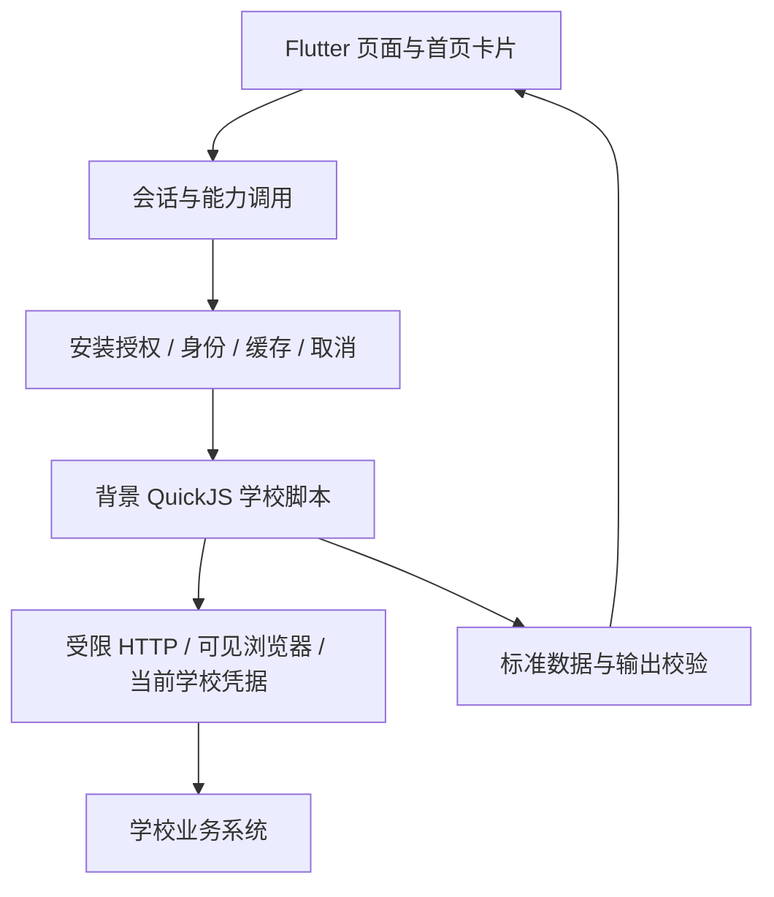

# Elecon 当前架构

当前主线是**受信学校脚本、宿主能力边界、标准业务数据和客户端页面**。学校变化集中在脚本，跨学校可复用的业务含义留在契约。决策基线见 [ADR-041](adr/adr_041_current_architecture.md)，开发入口见 [AGENTS](../AGENTS.md)。

## 已有实现

`school-scripts/` 是新学校源码；`adapters/_template/trusted/` 是现有源码模板。`contract/script-package.schema.json` 和 `contract/script-sdk/` 定义包与宿主 API；`contract/schema/` 定义数据，不能用模板名替代领域语义。客户端已按 [ADR-043](adr/adr_043_card_layout_and_overrides.md) 保存逐能力的默认/覆盖来源，更新不抢占；主包无需识别增强包。SDK 6 cards 仅建议有限展示，SDK 7 homeTitle 可命名学校首页。首页固定单元格沿列向上补空，拖动时暂时固定落点；图标与名称占 1×1、半宽摘要占 2×2，全宽详情按整行对齐；长按吸附拖动及显隐/尺寸/样式/格位按学校保存。逐卡片展示样式扩展入口已预留。

脚本可见本校授权凭据。SDK 2 namespace 只避免存储键冲突，同校共享是显式寻址，不是隔离权限。客户端保管主密钥、安装授权与执行代际；脚本不得读取其他学校身份或任意原生能力。输出 schema 校验不等于能识别任意秘密的防泄漏过滤。

公网 `server/src/public` 目前提供签名产物静态分发；`server/src/campus` 仍返回 501。新源码脚本没有生产服务端执行器。现有 V1 official/Broker/Masker 路径按[兼容边界](reference/legacy_compatibility.md)继续维护。

[ADR-046](adr/adr_046_triggered_script_requests.md) 废除新源码 action 通道。空调控件直接触发普通能力的一次控制 POST，结束后查询一次状态；不额外确认、不自动重发、不乐观更新。旧 action 包保留原安装内容与 digest，但需更新后才能执行；V1 边界不变。签到同样使用通用请求；学习通 QR 首片见 ADR-052。

[ADR-044](adr/adr_044_local_profiles.md) 的本地 Profiles 各自拥有会话、凭据/缓存和脚本安装授权；旧根目录原位归属 Profile 1，新用户重新选脚本。切换取消旧调用并重建页面导航；设置按 Profile 展示，保护状态用图标表达。非密学校首页布局与主题继续共享。

[ADR-045](adr/adr_045_script_qr_scanner.md) 的 SDK 8 可声明 `scanner` 并前台调用 `ctx.ui.scanQRCode()`，返回二维码文本或取消 null；后台拒绝，首片 Android/iOS，学习通增强包的受限扫码提交见 ADR-052。脚本保护仅完成[研究](research/script_protection_feasibility.md)，没有加密包或 VMP 加载器。

[ADR-048](adr/adr_048_schedule_navigation_and_segments.md) 的 `schedule.week` 1.1 提供学校时间分段与逐周课程预览，客户端拥有周按钮、滑动切周、满宽网格和重叠提示；1.0 继续按历史 schema 校验。[ADR-054](adr/adr_054_schedule_term_cache.md) 的 1.2 增加明确的整学期周详情，切周复用原始时效的缓存，过期后台刷新且保留当前网格；旧版本继续按各自契约读取。西电教学楼目录已核实并内置于学校脚本，占用情况仍实时查询。

[ADR-050](adr/adr_050_faculty_search.md) 的 `faculty.search` 1.0 提供公开教师检索，西电按官网单页查询；原生页面保留教师身份、分页、来源和简介，不获取凭据、不预加载或持久缓存检索结果。

按 [ADR-052](adr/adr_052_community_accounts_and_chaoxing.md)，论坛和消息 Tab 仅在当前学校有对应可执行包时显示。基本包提供睿思独立账号登录及本地退出；学习通第三方社区包由用户自行导入，客户端不内置或推荐。[ADR-055](adr/adr_055_checkin_locations_and_diagnostics.md) 的签到 1.1 增加用户指定地点矩阵及固定失败诊断，地点按本地身份/学校/来源保存，只有选中地点进入主动扫码请求。SDK 9 WebSocket 单独声明 wss origins，固定 DNS/TLS、长度/流量/时长预算，取消销毁；协议、token 和 protobuf 留在脚本。账号操作、消息和签到禁止预加载与首页缓存。

[ADR-061](adr/adr_061_message_history_and_storage.md) 增加学习通群聊/私聊会话、历史分页与一次纯文本发送。核心拥有原生聊天页面和按 Profile/学校/批准来源/服务账号隔离的 SQLite 库；SQL 在背景 isolate 执行，有界数据库快照沿用 H/S/M 保护，脚本没有数据库/文件接口。退出/撤销清除记录，撤回墓碑阻止旧页恢复正文；发送无确认时保留未知态、不自动重发。作业、课程、任务、活动及附件只显示不可点击摘要。旧 `messages.list` 窗口语义不变。论坛帖子、未读、附件操作及后台推送仍待实施，见[专项计划](planning/forum_and_messages.md)。

按 [ADR-053](adr/adr_053_provider_updates_and_service_cancellation.md)，同一基础包经批准升级后，其能力绑定同步声明的 schemaVersion；注册表 v3 兼容修复 v2 的旧版本绑定，保留学校、批准 digest、启用状态和显式覆盖选择。社区页面取消只撤销自身调用，学校身份变更仍撤销全部调用；睿思认证失败不阻塞学校功能。

[ADR-056](adr/adr_056_foreground_request_cards.md) 为已有签到能力增加首页入口，并复用通用前台请求组件；账号、扫码及网络协议仍由同来源脚本执行，只有按钮触发请求。按 [ADR-057](adr/adr_057_bounded_script_probes.md)，正式版日志可查看/复制经过严格格式校验的有界阶段探针；运行时日志页的自由文本仍仅用于 debug，探针没有原始响应记录或自动上传。课表沿用 `calendar.academic.currentWeek` 标记本周，首次打开以默认当前周缓存为先、选中周居中，切周带方向动画。首页更新时间按经过的分钟/小时展示，超过三天显示本地日期，原始时间与缓存 TTL 不变。

[ADR-058](adr/adr_058_foreground_device_inputs.md) 的 SDK 10 增加显式声明的前台拍照、选图和当前位置输入，宿主提供有界原生输入及二进制 HTTP body，学校脚本决定签到需求、坐标转换与上传协议。签到模板使用中性按钮，首页是唯一签到入口；消息 Tab 聚焦账号与消息。系统选图的短期生命周期租约不授权后台执行，身份与前台撤销仍生效。

[ADR-059](adr/adr_059_capability_configuration_state.md) 区分「未完善信息」和「请求失败」：固定 `configuration_required` 可用于任何能力，待配置标记绑定当前 Profile/学校/来源 digest/参数并保存在 H/S/M 后端；整体刷新跳过，明确的交互配置成功后恢复。[ADR-060](adr/adr_060_cache_first_startup.md) 先恢复当前身份和本地桌面，JS 及查询在首个桌面帧后启动；未使用的 Profile 延迟恢复，私密数据仍从受保护缓存读取。查询卡片本身承载查看语义，右上角刷新，详情不再堆叠重新查询文字按钮。

[ADR-062](adr/adr_062_app_tunnel_selection.md) 增加核心 APPTunnel 选择，按 Profile/学校保存；首版使用随构建固定的 Hermes/aTrust 原生桥，只服务本应用的 HTTP/WSS，不创建系统 VPN。普通脚本仍受 origin/IP、目标 TLS、取消与预算约束；失败停止，切换不重发。网关原站登录和会话材料由核心托管，H/S/M 保护；普通 WebView 尚未接隧道，选择后拒绝其直连。V1 在隧道模式拒绝执行，已有不可取消的 V1 操作结束前拒绝切换。

[ADR-063](adr/adr_063_conversation_names_and_order.md) 的 `messages.conversations` 1.1 支持确认有内容和源站最新消息时刻；超星 0.3.1 批量补全群名，核心与脚本按有内容优先、已知最新源站时间排序，离线使用同样证据，未知群组不等于空群。

## 后续方向

[ADR-042](adr/adr_042_providers_pages_enhancements.md)提出：用显式 provider 绑定连接学校包与增强包，以业务 feature 组合多个查询和页面，以固定原生模板复用展示。公开通知缓存优先试点；鉴权空教室和账户水电分别验证授权与隔离，不共享学生会话。

同名能力覆盖与有限卡片的首片已由 ADR-043 实施；通用页面注册、匿名增强权限及中继仍为 **Proposed**。现有能力的原生查看页、周课表与今日时间线按 [ADR-047](adr/adr_047_feature_pages_and_card_qr.md) 实施；普通首页点击不改尺寸。校园卡二维码独立于余额/流水，不持久缓存。一卡通消费分布/每日变化由核心按标准流水派生，按币种和日期范围展示，标明已加载记录及分页完整性；无流水能力或无可统计消费时隐藏图。代码观察与切片见[接口审计](reference/interface_evolution.md)、[中继研究](research/relay_enhancement_feasibility.md)及[实施计划](planning/platform_evolution.md)。

## 状态来源

| 问题 | 入口 |
|---|---|
| 哪些决策有效 | [ADR 索引](adr/README.md) |
| 现有脚本实现与验收 | [trusted_scripts](planning/trusted_scripts.md) |
| 新页面与增强包先做哪步 | [platform_evolution](planning/platform_evolution.md) |
| 如何打包和安装 | [受信脚本使用文档](reference/trusted_scripts.md) |
| 历史论证与签收 | [archived](archived/README.md) |

决策接受、代码存在、自动测试、真机与人工签收分别记录；任何一项不能推导其余项已完成。
