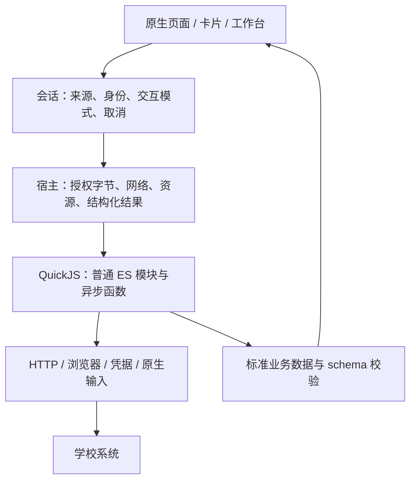

# Elecon 当前架构

学校差异由用户安装的受信 JavaScript 扩展实现；核心提供跨学校的执行、身份、网络、存储、认证输入和展示基底。脚本作者使用普通 ES 模块、异步函数与异常，学校协议和交互流程不进入核心。

本文是现行架构的唯一维护入口。作者从 [Wiki](wiki/README.md) 开始，接口字段以 [SDK 类型](../contract/script-sdk/types.d.ts)、[包 schema](../contract/script-package.schema.json)和[领域契约](../contract/schema/)为准；实施状态见[统一计划](planning/implementation.md)。[ADR 索引](adr/README.md)用于追溯决策原因，不要求逐篇阅读。

## 模块与职责

| 模块 | 核心责任 | 脚本责任 | 实现入口 |
|---|---|---|---|
| 安装与来源 | 审查包内容、学校和网络范围；保存批准 digest；更新重新确认；逐能力来源及显式覆盖 | 声明能力、资源、账号与运行需要；普通模块函数只在必要时注册成宿主入口 | [scripts](../client/lib/core/scripts/)、[打包器](../tools/src/script/package.ts) |
| 调用与生命周期 | 校验来源、参数、身份和取消；处理交互、错误、输出及资源回收 | `capabilities[id](ctx, params)` 返回标准数据或抛异常；辅助函数保持普通 JS | [script_session](../client/lib/session/script_session.dart)、[runtime](../client/lib/core/scripts/runtime.dart)、[查询门面](../client/lib/session/capability_query.dart) |
| 身份、凭据与认证 | Profile 隔离、受保护存储、账号页面、短期输入与恢复额度；主密钥不离开宿主 | 学校 SSO、Cookie/token、母子票据、登录成功验证与学校错误判定 | [credentials](../client/lib/core/scripts/credentials.dart)、[account_auth](../client/lib/core/scripts/account_auth.dart)、[账号手册](wiki/accounts.md) |
| HTTP、WSS、浏览器与隧道 | 声明网络范围、DNS/TLS、跳转、预算和取消；Hermes 原生传输与独立秘密；浏览器容器 | URL、协议、签名、请求体、DOM 和业务成功条件 | [transport](../client/lib/core/transport/)、[browser](../client/lib/core/scripts/browser.dart)、[浏览器手册](wiki/browser.md) |
| 标准业务数据 | 时间、单位、缺失值、实体身份、版本和输出校验；可共享的原生领域组件 | 把学校数据归一为约定含义；网页局部状态无需进入全局 schema | [contract](../contract/)、[解码器](../client/lib/ui/home/decoders/)、[学校源码](../school-scripts/) |
| 页面、首页与缓存 | 原生路由、输入、卡片布局和用户选择；缓存固定身份、来源 digest、参数、语言与原始时间 | 文案、查询条件和已有展示建议；不把业务流程编码成 Widget tree | [home](../client/lib/ui/home/)、[卡片手册](wiki/cards.md)、[交互手册](wiki/interactions.md) |

## 作者运行环境

普通 ES 模块经过构建打包为受信源码，在背景 QuickJS isolate 运行。模块和函数边界不引入新的流程语言；包版本、SDK 版本、业务 schema 版本分别管理。只有跨宿主调用的入口需要注册，内部认证步骤、工具函数和网页事件使用普通 JS。

[ADR-081](adr/adr_081_script_runtime_consolidation.md) 收敛 SDK17 的请求/响应、取消与错误协议，专有端口集中到 `elecon` 命名空间；旧 `ctx` 与 SDK1–16 保持其版本语义。标准 API 的实际支持范围、生命周期和不支持项只维护在[SDK 手册](wiki/sdk-and-host.md)，不将标准形状等同于完整浏览器或 Node 环境。

运行错误以稳定分类跨宿主传递，JS 继续使用 `throw`、`try/catch` 和 `Error`。业务码和宿主分类分开；宿主桥不再通过异常显示文字判定错误。学校侧旧认证封装的 message 分支迁移仍见统一计划。取消、资源超限、认证需要交互和业务失败不能相互冒充。恢复策略由调用层与学校流程明确实施，错误本身不授权重试。

## 执行与身份边界

[ADR-099](adr/adr_099_bounded_parallel_queries.md) 的 SDK20 为能力声明完整凭据地址；跨包同地址互斥、独立地址可并行，省略声明或旧 SDK 保留学校独占。单宿主全局最多3个 QuickJS调用、8个HTTP在途、每origin 2个；首页预加载最多1个，不占满主动查询名额。宿主协调共享存储及可取消队列，脚本决定认证恢复和协议依赖；namespace不是权限沙箱。相同身份、来源、参数、语言和交互模式的普通只读请求共用在途工作，消费者独立取消。SDK20 budget.remaining() 仅观察剩余额度，不扩大硬限制。

[ADR-097](adr/adr_097_registered_script_execution.md) 的 SDK19 提供前台查询作用域、JSON 内存存储、`handlers` 稳定名称注册与单次定时预约。后续执行新建 QuickJS，只携带存储引用及宿主上下文；不保存函数闭包或临时业务参数。原生页面拥有作用域，离页/后台/身份或来源失效撤销预约与排队调用；脚本决定下一次时刻。二维码已接入，旧 SDK 保留原续订行为。卡片与详情仍沿用缓存及版本通知，暂不增加通用广播；持久计划与系统唤醒仍属后续工作。

- 执行字节必须匹配批准 digest。来源更新、禁用、退出和切身份使旧执行及迟到结果失效；显示来源或卡片不授予执行权限。
- 当前学校受信脚本可处理其授权凭据；UI 不取得完整凭据库或主密钥。namespace 是寻址与 API 组织方式，同校共享须显式寻址，不是包间最小权限沙箱。
- [ADR-095](adr/adr_095_protected_store_recovery.md) 的 H 档恢复失败保留密文与原密钥，阻断使用并提供显式重试；不自动清除、降级或创建替代密钥。归档合并协调同一共享凭据库的写入，尚不支持多个引擎同时持有整库快照。
- 宿主不开放任意文件、进程、FFI、raw socket 或原生模块侧载。公网静态分发不持凭据或私密数据；校内部署位置本身不产生共享授权。
- 用户按钮发起普通请求，无另一个 action 通道或逐次额外确认。展示、预加载和缓存恢复不能发起写操作；发送结果未知时不自动重放。
- 只读查询可按明确学校认证证据恢复；验证码、MFA、网络失败和合法无权限不等于密码错误。成功登录仍须验证目标业务会话。
- 显式声明的账号登录先清除当前学校所有包的业务查询缓存并等待持久化，再执行学校登录；清理失败不执行登录，取消或拒绝登录不恢复旧快照。业务数据代际同时使旧页面结果和排队查询失效，与登录窗口的执行代际分开。同校凭据及其他学校缓存不因这一步清除；普通查询内的票据续期不触发此清理。

## 已有产品能力及限制

原生领域组件覆盖课表、成绩、考试、空教室、通知、校园卡、借阅、水电、空调、电话黄页与教师检索等；具体学校是否支持以安装包声明及源站验证为准。SDK18 的 [绑定页面](adr/adr_086_portal_pages.md) 将首页有限高度摘要与详情操作分开，支持原生/论坛/消息/受控网页模板及至多三个脚本 tab；一级卡片绑定同包页面，generic 提供兜底。个人借阅详情组合独立书目检索与借阅列表，profile 显示已有 profile.me.name。SDK12 同型卡片实例固定来源，默认能力覆盖独立保存；更新不抢占用户布局。成绩学期与教室筛选、课表缓存和时间轴复用共性组件。[ADR-089](adr/adr_089_schedule_break_segments.md) 的课表 1.3 允许学校提供具名休息段和明确时区，不据此推断教室可用。[ADR-082](adr/adr_082_script_query_forms.md) 的 query.controls 2.0 由脚本创建有类型的字段实例，核心不预置学校业务筛选清单；独立 filters 参数、动态依赖与旧 1.0 表单分别维护。[ADR-083](adr/adr_083_deferred_query_fields.md) 的 2.1 可选字段按依赖延迟解析，基础查询不等待补充；[ADR-091](adr/adr_091_query_form_cache.md) 分别缓存表单与草稿，可选条件折叠且按需加载。静态目录、学校时间和选项取数策略仍由脚本负责。

账号声明支持独立服务与同包登录/状态入口；保存密码先验证再替换。SDK16 可声明 Hermes 网关账号和逐能力依赖，不满足依赖时停止，不直连回退；普通 WebView 尚未接入 APPTunnel。[ADR-092](adr/adr_092_climate_binding_and_controls.md) 将本地空调绑定与远端状态分开，扫码复用既有权限，命令仍单次发送并核验。当前包内网页是 Android 离线 HTML 与固定 DOM 操作模式，作者网页 JS/直接网络仍关闭；这描述旧模式的实现，不是扩展目标的永久限制。

消息已有会话、群/私聊历史及一次文本发送；[ADR-098](adr/adr_098_conversation_avatars.md) 的会话1.3增加脚本取得的有界内联头像，原生拼图不另发图片网络请求，受保护 SQLite 由核心托管；可选 `messages.enrich` 为任意后端提供至多8个会话的稀疏信息补全，不改变目录实体集合、目录时效或发送权限，没有头像、排序或补全能力均合法；论坛帖子、未读、附件操作及推送尚未实现。系统 AI 为四个具名只读 AppFunctions，当前身份逐次授权，不提供任意脚本执行口。[ADR-096](adr/adr_096_system_classroom_query_inputs.md) 将系统教室查询限定为明确楼栋，缺条件时提供同来源标准目录和原生入口，发布结果前验证学校时区；不猜脚本自定义字段。[ADR-085](adr/adr_085_feature_shortcuts.md) 的 Android 快捷方式及 App Actions 另提供固定原生功能的页面入口，经过正常恢复、选校与来源绑定，不授予 AI 数据读取或控制权限。[ADR-090](adr/adr_090_schedule_widgets.md) 的 Android 课表小部件只消费前台缓存；用户逐实例允许桌面展示，绑定身份及批准来源，H/S 保存最小加密快照、M 仅内存，身份/来源变化遮蔽，原生进程重建需应用重新核验。原生权限、平台支持和真实服务验收不能从 schema 存在推断。

## 已接受的扩展目标

[ADR-080](adr/adr_080_trusted_script_extensibility.md) 接受长期 WebView JS、自绘按钮/框图、全部能力首页入口、脚本决定使用的独立验证码/MFA 界面，以及用户启用后自动执行的定时任务。一次调用、长期网页会话和持久计划分别管理生命周期，复用同一调用语义；不能通过无限延长短请求超时实现全部目标。

远端增强须兑现网页网络范围、桥接来源与取消，依赖隧道时不能直连。自动化须记录时间窗口、错过、认证等待和未知结果，不能承诺所有平台锁屏或退出后精确执行。上述接口的实施状态与验证条件只维护在[统一计划](planning/implementation.md#受信扩展)。

## 本地开发调试

[ADR-100](adr/adr_100_local_debug_tools.md)在 Debug 构建默认提供私有文件源码安装/替换/删除，无额外变量开关；命令固定 Profile 和摘要，异步读取及提交排队后复核前台生命周期，不提供脚本执行入口。同版本替换只在该开发门内放行，Profile/Release 不提供文件调试入口；普通源码安装与 V1 验签保持各自边界。Debug日志由DevLog净化后写入私有轮转文件供ADB读取，使用方法见[调试手册](wiki/debugging.md)。应用标识为`com.ncclab.elecon`；旧安装私有数据及密钥不自动迁移。

## 兼容、发布与证据

仍有消费者的 V1 official/Broker/Masker 路径按[兼容维护边界](reference/legacy_compatibility.md)维护；不为它扩充学校 DSL。可以完整退役旧调用链，但文档归档不等于删除运行代码或保护。`server/src/public` 是零凭据静态分发，`server/src/campus` 仍是 stub，没有新源码服务端生产执行器。

架构或契约含义变化记录整体决定；普通实现拆分和已有决定覆盖的功能不另造 ADR。当前开发阶段可显式升版破坏性更新，不能无声改变旧字段。依[功能工作流](rules/feature_workflow.md)和[测试规则](rules/testing.md)验证实际改动；代码、自动测试、平台真机、学校验证与人工审阅分别记录。历史实现流水见[收敛快照](archived/2026-11-04/README.md)。
