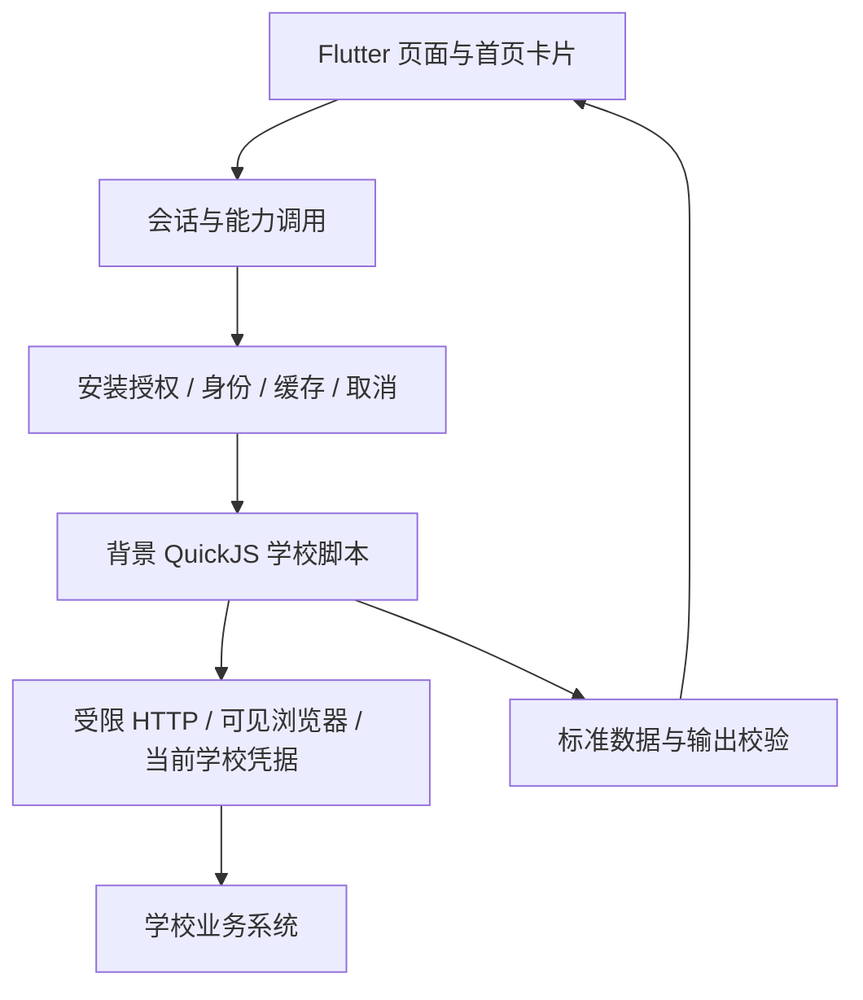

> 历史快照（2026-11-04）。原路径：`docs/architecture.md`。退出日常维护；当前事实见[现行架构](../../../architecture.md)和[统一实施计划](../../../planning/implementation.md)。历史批准、测试结果及未验收事实按原时间解释。

# Elecon 当前架构

当前主线是**受信学校脚本、宿主能力边界、标准业务数据和客户端页面**。学校变化集中在脚本，跨学校可复用的业务含义留在契约。决策基线见 [ADR-041](../../../adr/adr_041_current_architecture.md)，开发入口见 [AGENTS](../../../../AGENTS.md)。

逐功能的宿主、脚本、契约与页面职责见[核心与脚本边界](reference/core_script_boundaries.md)。旧文档与测试整理依 [ADR-065](../../../adr/adr_065_repository_cleanup.md)，归档和夹具迁移不表示活跃 V1 执行器已删除。

## 已接受的扩展方向（待实施）

[ADR-080](../../../adr/adr_080_trusted_script_extensibility.md) 将受信脚本作为可编程扩展：允许长期附加 WebView JS、自绘框图和按钮、用户启用的定时自动操作，以及所有能力绑定首页入口。核心提供跨学校共性的网页会话、调度、输入与展示设施；学校协议、交互和自动化策略留在脚本。验证码/MFA 使用核心独立挑战界面，由脚本决定何时调用及如何验证。

此决定局部修订有限卡片、固定 DOM 和仅按钮触发的长期设计边界；下文描述现有 SDK 行为，不能据此宣称新接口已经实现。安装 digest、当前身份、网络范围、取消与资源管理继续保留；新模式不要求每个自动动作重复确认，未知提交仍不自动重发。切片与验证见[功能补充计划](planning/feature_supplements.md#受信脚本扩展adr-080)。

## 已有实现

`school-scripts/` 是新学校源码；`adapters/_template/trusted/` 是现有源码模板。`contract/script-package.schema.json` 和 `contract/script-sdk/` 定义包与宿主 API；`contract/schema/` 定义数据，不能用模板名替代领域语义。客户端已按 [ADR-043](../../../adr/adr_043_card_layout_and_overrides.md) 保存逐能力的默认/覆盖来源，更新不抢占；主包无需识别增强包。SDK 6 cards 仅建议有限展示，SDK 7 homeTitle 可命名学校首页。首页固定单元格沿列向上补空，拖动时暂时固定落点；图标与名称占 1×1、半宽摘要占 2×2，全宽详情按整行对齐；长按吸附拖动及显隐/尺寸/样式/格位按学校保存。逐卡片展示样式扩展入口已预留。

脚本可见本校授权凭据。SDK 2 namespace 只避免存储键冲突，同校共享是显式寻址，不是隔离权限。客户端保管主密钥、安装授权与执行代际；脚本不得读取其他学校身份或任意原生能力。输出 schema 校验不等于能识别任意秘密的防泄漏过滤。

公网 `server/src/public` 目前提供签名产物静态分发；`server/src/campus` 仍返回 501。新源码脚本没有生产服务端执行器。现有 V1 official/Broker/Masker 路径按[兼容边界](../../../reference/legacy_compatibility.md)继续维护。

[ADR-046](../../../adr/adr_046_triggered_script_requests.md) 废除新源码 action 通道。空调控件直接触发普通能力的一次控制 POST，结束后查询一次状态；不额外确认、不自动重发、不乐观更新。旧 action 包保留原安装内容与 digest，但需更新后才能执行；V1 边界不变。签到同样使用通用请求；学习通 QR 首片见 ADR-052。

[ADR-044](../../../adr/adr_044_local_profiles.md) 的本地 Profiles 各自拥有会话、凭据/缓存和脚本安装授权；旧根目录原位归属 Profile 1，新用户重新选脚本。切换取消旧调用并重建页面导航；设置按 Profile 展示，保护状态用图标表达。非密学校首页布局与主题继续共享。

[ADR-045](../../../adr/adr_045_script_qr_scanner.md) 的 SDK 8 可声明 `scanner` 并前台调用 `ctx.ui.scanQRCode()`，返回二维码文本或取消 null；后台拒绝，首片 Android/iOS，学习通增强包的受限扫码提交见 ADR-052。脚本保护仅完成[研究](../../../research/script_protection_feasibility.md)，没有加密包或 VMP 加载器。

[ADR-048](../../../adr/adr_048_schedule_navigation_and_segments.md) 的 `schedule.week` 1.1 提供学校时间分段与逐周课程预览，客户端拥有周按钮、滑动切周、满宽网格和重叠提示；1.0 继续按历史 schema 校验。[ADR-054](../../../adr/adr_054_schedule_term_cache.md) 的 1.2 增加明确的整学期周详情，切周复用原始时效的缓存，过期后台刷新且保留当前网格；旧版本继续按各自契约读取。西电教学楼目录已核实并内置于学校脚本，占用情况仍实时查询。

[ADR-050](../../../adr/adr_050_faculty_search.md) 的 `faculty.search` 1.0 提供公开教师检索，西电按官网单页查询；原生页面保留教师身份、分页、来源和简介，不获取凭据、不预加载或持久缓存检索结果。

按 [ADR-052](../../../adr/adr_052_community_accounts_and_chaoxing.md)，论坛和消息 Tab 仅在当前学校有对应可执行包时显示。基本包提供睿思独立账号登录及本地退出；学习通第三方社区包由用户自行导入，客户端不内置或推荐。[ADR-055](../../../adr/adr_055_checkin_locations_and_diagnostics.md) 的签到 1.1 增加用户指定地点矩阵及固定失败诊断，地点按本地身份/学校/来源保存，只有选中地点进入主动扫码请求。SDK 9 WebSocket 单独声明 wss origins，固定 DNS/TLS、长度/流量/时长预算，取消销毁；协议、token 和 protobuf 留在脚本。账号操作、消息和签到禁止预加载与首页缓存。

[ADR-061](../../../adr/adr_061_message_history_and_storage.md) 增加学习通群聊/私聊会话、历史分页与一次纯文本发送。核心拥有原生聊天页面和按 Profile/学校/批准来源/服务账号隔离的 SQLite 库；SQL 在背景 isolate 执行，有界数据库快照沿用 H/S/M 保护，脚本没有数据库/文件接口。退出/撤销清除记录，撤回墓碑阻止旧页恢复正文；发送无确认时保留未知态、不自动重发。作业、课程、任务、活动及附件只显示不可点击摘要。旧 `messages.list` 窗口语义不变。论坛帖子、未读、附件操作及后台推送仍待实施，见[专项计划](planning/forum_and_messages.md)。

按 [ADR-053](../../../adr/adr_053_provider_updates_and_service_cancellation.md)，同一基础包经批准升级后，其能力绑定同步声明的 schemaVersion；注册表 v3 兼容修复 v2 的旧版本绑定，保留学校、批准 digest、启用状态和显式覆盖选择。社区页面取消只撤销自身调用，学校身份变更仍撤销全部调用；睿思认证失败不阻塞学校功能。

[ADR-056](../../../adr/adr_056_foreground_request_cards.md) 为已有签到能力增加首页入口，并复用通用前台请求组件；账号、扫码及网络协议仍由同来源脚本执行，只有按钮触发请求。按 [ADR-057](../../../adr/adr_057_bounded_script_probes.md)，正式版日志可查看/复制经过严格格式校验的有界阶段探针；运行时日志页的自由文本仍仅用于 debug，探针没有原始响应记录或自动上传。课表沿用 `calendar.academic.currentWeek` 标记本周，首次打开以默认当前周缓存为先、选中周居中，切周带方向动画。首页更新时间按经过的分钟/小时展示，超过三天显示本地日期，原始时间与缓存 TTL 不变。

[ADR-058](../../../adr/adr_058_foreground_device_inputs.md) 的 SDK 10 增加显式声明的前台拍照、选图和当前位置输入，宿主提供有界原生输入及二进制 HTTP body，学校脚本决定签到需求、坐标转换与上传协议。签到模板使用中性按钮，首页是唯一签到入口；消息 Tab 聚焦账号与消息。系统选图的短期生命周期租约不授权后台执行，身份与前台撤销仍生效。

[ADR-059](../../../adr/adr_059_capability_configuration_state.md) 区分「未完善信息」和「请求失败」：固定 `configuration_required` 可用于任何能力，待配置标记绑定当前 Profile/学校/来源 digest/参数并保存在 H/S/M 后端；整体刷新跳过，明确的交互配置成功后恢复。[ADR-060](../../../adr/adr_060_cache_first_startup.md) 先恢复当前身份和本地桌面，JS 及查询在首个桌面帧后启动；未使用的 Profile 延迟恢复，私密数据仍从受保护缓存读取。查询卡片本身承载查看语义，右上角刷新，详情不再堆叠重新查询文字按钮。

[ADR-062](../../../adr/adr_062_app_tunnel_selection.md) 增加核心 APPTunnel 选择，按 Profile/学校保存；首版使用随构建固定的 Hermes/aTrust 原生桥，只服务本应用的 HTTP/WSS，不创建系统 VPN。普通脚本仍受 origin/IP、目标 TLS、取消与预算约束；失败停止，切换不重发。网关原站登录和会话材料由核心托管，H/S/M 保护；普通 WebView 尚未接隧道，选择后拒绝其直连。V1 在隧道模式拒绝执行，已有不可取消的 V1 操作结束前拒绝切换。

[ADR-063](../../../adr/adr_063_conversation_names_and_order.md) 的 `messages.conversations` 1.1 支持确认有内容和源站最新消息时刻；超星 0.3.1 批量补全群名，核心与脚本按有内容优先、已知最新源站时间排序，离线使用同样证据，未知群组不等于空群。

[ADR-064](../../../adr/adr_064_script_accounts_and_tunnel_credentials.md) 的 SDK 11 统一声明脚本账号名称、用途、登录说明及可选同包登录绑定，设置按当前学校展示并固定来源调用。旧包仍为未声明，更新需重新批准。Hermes 设置支持独立的受保护账号凭证与主动单次密码登录；验证码/MFA 保留官方网页登录，保存账号不等于登录，普通脚本不能取得隧道密码或会话。

## 后续方向

[ADR-067](../../../adr/adr_067_classroom_availability_intervals.md) 的空教室 1.2 补充绝对时间区间与来源原因，原生页面共用时间轴和当前线，整段空闲筛选保留未知缺口。成绩按脚本 `term.list` 的学期 id/name 查询并隔离缓存。西电只读教务请求遇到子票据失效时，先用现有 IDS 母票据换签并验证业务 API，失败不循环尝试；SDK14 保存密码登录见 ADR-072，隐藏 WebView 尚未开放。

[ADR-068](../../../adr/adr_068_script_interaction_and_recovery.md) 定义脚本条件/按钮、认证恢复事件、内嵌网页与双层国际化。核心已有 uz/ru/fa 语言资源；[ADR-070](../../../adr/adr_070_script_localization.md) 的 SDK13 将作者自选语言字典纳入包 digest、安装审查和 `ctx.i18n`，按请求语言隔离缓存，变更语言撤销旧调用。脚本语言不受核心已翻译语言限制，[官方代码参考](../../../reference/script_language_codes.md)用于作者核对。[ADR-071](../../../adr/adr_071_script_query_controls.md) 已接入同来源的成绩/教室条件模板，脚本提供文案、选项和已有标准参数绑定，核心渲染并在提交后应用。

[ADR-072](../../../adr/adr_072_saved_password_recovery.md) 的 SDK14 实施保存密码优先登录、先验证再替换、持久一次恢复门与结构化账号事件；隐藏浏览器网络覆盖未完成，生产包必须声明 silentWeb:false。[ADR-073](../../../adr/adr_073_packaged_web_content.md) 将包内 HTML 纳入授权，Android 通过共享[浏览器容器](../../../reference/script_browser_surfaces.md)显示；文档脚本及直接网络关闭，学校脚本使用固定 DOM 操作、真实用户事件与 ctx.fetch 提交。任意远端表单、隐藏认证与 WebView APPTunnel 尚未开放。[ADR-069](../../../adr/adr_069_android_app_functions.md) 的系统 AI 定义由 [ADR-074](../../../adr/adr_074_android_app_functions_implementation.md) 实施四个具名 AppFunctions，当前身份按查询单独临时授权，后台不弹登录，结果投影不透传开放 schema 扩展。具体实现/待办见[功能补充切片](planning/feature_supplements.md)。[ADR-075](../../../adr/adr_075_hermes_status_rotation.md) 补状态检查 SID 的受保护跨调用保存；Hermes 当前失效码、执行内轮换和剩余协议差异见[对齐研究](../../../research/hermes_zju_connect_alignment.md)。

[ADR-042](../../../adr/adr_042_providers_pages_enhancements.md)提出：用显式 provider 绑定连接学校包与增强包，以业务 feature 组合多个查询和页面，以固定原生模板复用展示。公开通知缓存优先试点；鉴权空教室和账户水电分别验证授权与隔离，不共享学生会话。

同名能力覆盖与有限卡片的首片已由 ADR-043 实施；通用页面注册、匿名增强权限及中继仍为 **Proposed**。现有能力的原生查看页、周课表与今日时间线按 [ADR-047](../../../adr/adr_047_feature_pages_and_card_qr.md) 实施；普通首页点击不改尺寸。校园卡二维码独立于余额/流水，不持久缓存。一卡通消费分布/每日变化由核心按标准流水派生，按币种和日期范围展示，标明已加载记录及分页完整性；无流水能力或无可统计消费时隐藏图。代码观察与切片见[接口审计](../../../reference/interface_evolution.md)、[中继研究](../../../research/relay_enhancement_feasibility.md)及[实施计划](planning/platform_evolution.md)。

## 状态来源

| 问题 | 入口 |
|---|---|
| 哪些决策有效 | [ADR 索引](adr/README.md) |
| 现有脚本实现与验收 | [trusted_scripts](planning/trusted_scripts.md) |
| 新页面与增强包先做哪步 | [platform_evolution](planning/platform_evolution.md) |
| 如何打包和安装 | [受信脚本使用文档](reference/trusted_scripts.md) |
| 历史论证与签收 | [archived](../../README.md) |

决策接受、代码存在、自动测试、真机与人工签收分别记录；任何一项不能推导其余项已完成。

### ADR-066：领域查询、账号状态和多来源

SDK 12 的显式卡片 id/title 支持同类型多个实例，各实例查询/缓存/详情/登录固定包与批准 digest，不改变默认 capability 覆盖。领域组件与标准数据解码器已拆分，`CapabilityQueries` 和 `CachedQuerySection` 承担共同来源与生命周期。

`account.session` 区分 authenticated/signedOut/expired/unknown；只读检查禁用交互，重登必须重新验证。脚本可声明内置 APPTunnel 服务并包装账号，宿主固定页面管理 Hermes 密钥/会话。消息活动/指令仅标识；发送权限由当前在线结果和脚本实际发送前复核共同约束。

细节见 [ADR-066](../../../adr/adr_066_feature_sources_and_account_state.md) 与[功能边界](reference/core_script_boundaries.md)。这不实施任意页面注册、增强包独立沙箱或脚本侧原生模块加载。

[ADR-076](../../../adr/adr_076_script_selection_account_checks.md) 为用户选择学校脚本、切换能力来源及恢复默认来源加入即时提示和同来源账号检查。检查使用已声明的只读入口，逐账号保留未登录、过期、未知和未提供检查的区别，不阻塞页面操作。西电子票据失效由脚本先尝试已有 IDS 换签并验证业务，不能直接推断主账号失效。

[ADR-077](../../../adr/adr_077_declared_account_credential_reuse.md) 的 SDK15 允许脚本显式声明同包保存密码账号用于指定 HTTPS 网关的 Hermes 登录。宿主仅在目标账号前台登录时转交源密码，认证后检查目标会话再保存，不复制源密码；学校脚本负责共享关系与业务检测。示例见[凭据复用参考](../../../reference/script_credential_reuse.md)，生产西电包尚未声明未经核实的 IDS→VPN 关系。

[ADR-078](../../../adr/adr_078_script_tunnel_accounts.md) 的 SDK16 由账号声明固定 APPTunnel 网关、认证域、服务端节点证书指纹和密码/官方网页认证方式，客户端提供统一原生收集框及只读连接详情。能力或普通账号通过 `appTunnelAccountId` 声明依赖；宿主校验会话目标，不满足时停止，不直连回退。SDK16 未声明依赖的能力直连，旧 SDK 保留原路由语义；设置中的通用隧道入口由脚本账号入口替代。西电 0.26.0 为睿思声明依赖；当前 aTrust 区分 CAS 与本地密码认证，使用官方 CAS 网页，不把 IDS 密码提交给本地域。普通 WebView 的 APPTunnel 支持仍未实施。

[ADR-079](../../../adr/adr_079_school_presentation_and_titles.md) 的 `school.id/name/type` 只负责展示院校分组与身份类型。西电本科/研究生共用学校主标题、类型作副标题，原 `schoolId` 继续隔离授权与凭据。主标题单行缩至最小字号后横向滚动，保留系统文字缩放、RTL 与减少动态效果偏好；学校脚本不控制原生布局。
