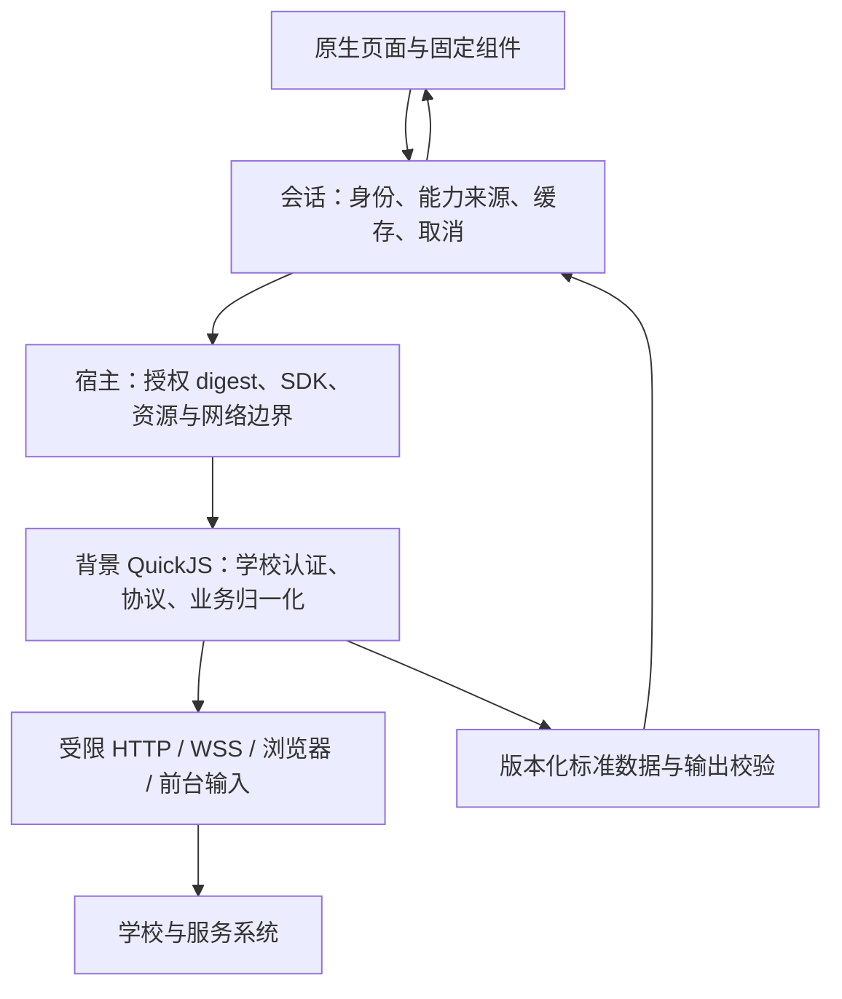

> 历史快照（2026-11-04）。原路径：`docs/reference/core_script_boundaries.md`。退出日常维护；当前事实见[现行架构](../../../../architecture.md)和[统一实施计划](../../../../planning/implementation.md)。历史批准、测试结果及未验收事实按原时间解释。

# 核心与学校脚本的功能边界

> 2026-11-03 代码盘点（含 ADR-076–079）。本文解释当前抽象与实现位置，不创建 SDK、业务契约或验收结论。决策以[架构](../architecture.md)和 [ADR 索引](../adr/README.md)为准；学校实际验收见[实施记录](../planning/trusted_scripts.md)。

学校协议变化应主要修改学校脚本；跨学校的业务含义进入契约；身份、执行授权、网络与设备权限由宿主执行；页面、布局和交互由客户端决定。“核心”在本文指宿主、会话和客户端业务层的合称，下面按职责进一步拆开。

## 新方向与当前实现的区别

[ADR-080](../../../../adr/adr_080_trusted_script_extensibility.md) 已接受受信脚本的长期 WebView JS、自绘交互、定时自动操作和所有能力首页入口。核心后续提供通用会话、调度及独立验证码/MFA 挑战页面，脚本决定认证步骤和学校业务策略。下表中的固定组件、有限卡片及网页限制是当前 SDK 实现，不是新扩展的永久上限；接口及切片状态见[功能补充计划](../planning/feature_supplements.md#受信脚本扩展adr-080)。

## 1. 从页面到学校的抽象层

| 层 | 负责什么 | 不应承接什么 | 实现入口 |
|---|---|---|---|
| 契约 | 能力名、输入输出、单位、时间、缺失值、实体与版本语义；包声明和 SDK | 学校 URL、登录算法、Widget 布局 | [registry](../../../../../contract/capability/registry.json)、[schema](../../../../../contract/schema)、[SDK](../../../../../contract/script-sdk/types.d.ts) |
| 客户端页面与业务展示 | 路由、固定控件、展示状态、用户输入、跨校通用派生 | 学校响应字段解析、学校密码加密与业务签名 | [home](../../../../../client/lib/ui/home)、[community](../../../../../client/lib/ui/community) |
| 会话与来源 | Profile/学校身份、批准来源绑定、取消、缓存、服务账号和消息归档生命周期 | 把学校 Cookie 名或接口成功码当作通用业务语义 | [SessionController](../../../../../client/lib/session/session_controller.dart)、[script_session](../../../../../client/lib/session/script_session.dart)、[profile_controller](../../../../../client/lib/session/profile_controller.dart) |
| 脚本宿主 | 安装 digest、SDK/声明校验、背景运行、预算、受限网络与原生输入 | 学校协议编排；任意文件、进程、FFI、raw socket 或原生模块侧载 | [scripts](../../../../../client/lib/core/scripts) |
| 学校脚本 | 认证、Cookie/token、请求及签名、DOM、业务字段和校本规则归一化 | 安装授权、其他学校凭据、任意原生 UI、数据库访问 | [西电](../../../../../school-scripts/xidian/src)、[学习通](../../../../../school-scripts/xidian-chaoxing/src) |
| 平台设施 | H/S/M 存储、编译内传输桥、相机/扫码/定位等原生端口 | 从脚本动态安装原生实现；默认获得校内数据共享授权 | [credential](../../../../../client/lib/core/credential)、[transport](../../../../../client/lib/core/transport)、[Hermes 原生桥](../../../../../native/hermes_app_tunnel) |

包版本、SDK 版本、数据 schema 版本独立裁定。一个页面可以组合多个能力，同一能力可以供卡片和详情页共用；能力不是页面注册表。首页领域组件通过 `CapabilityQueries` 绑定查询来源，`CachedQuerySection` 统一缓存与状态，领域 decoder 只转换标准数据。这是有限原生模板的共享层；任意页面注册仍未实现。

## 2. 共用能力和安全边界

| 功能 | 核心责任 | 脚本责任与当前限制 |
|---|---|---|
| 安装、更新与同名能力覆盖 | 展示包内容/学校/网络范围，保存批准 digest；执行前确认来源与字节；用户显式选择覆盖来源，更新不抢占 | 声明能力、网络和有限卡片建议；主包无需识别增强包。新源码允许未签名安装，不借用 V1 official 验签门 |
| Profile、学校和账号 | Profile 各自持有会话/凭据/安装授权；身份改变撤销调用、清理页面；SDK 12 账号按学校与来源展示，同包登录与 `account.session` 检查固定 digest，网络失败保留 unknown | 声明账号名称、用途、登录说明，判定 authenticated/signedOut/expired/unknown，返回账号信息并处理重登。namespace 是本校寻址，受信同校脚本可显式共享，不是包间最小权限沙箱 |
| 凭据与认证 | 保管主密钥和完整凭据库；只向当前学校执行提供授权凭据端口；提供受限浏览器和短期输入 | 学校 SSO、验证码/MFA 页面交互、成功判定、Cookie/token 保存和重认证。UI 可承接当次输入，不取得完整凭据库 |
| HTTP、WSS 与浏览器 | 声明的 origin/IP、DNS/TLS、跳转、预算与取消；浏览器独占及关闭清理；WSS 限流和时长 | 学校 URL、协议、请求体、headers、token、protobuf、DOM 和业务成功条件 |
| APPTunnel | 固定构建的 Hermes/aTrust 桥、受保护账号/会话、统一原生输入；SDK16 按功能依赖核对网关/域/证书，缺失停止；未声明依赖则直连。旧 SDK 保留按 Profile/学校选择 | SDK16 声明目标配置、密码/官方网页方式及能力/账号的 `appTunnelAccountId`，负责学校业务可用性检测；不获得原生隧道密码或会话。普通 WebView 尚未接隧道，依赖隧道时拒绝其直连；不创建系统 VPN |
| 学校与类型标题 | 分级选择、单行缩字/滚动、类型副标题、RTL 与无障碍；原 schoolId 继续决定授权隔离 | SDK16 `school.id/name/type` 提供展示分组与文本；不得借相同院校名合并凭据或授权 |
| 缓存与启动 | 受保护缓存按身份、来源 digest、能力和参数隔离；保留原始时间/TTL；先恢复本地桌面再查询；`configuration_required` 单独记录 | 声明允许的预加载/缓存策略，输出缺配或业务结果；账号、签到、控制、消息发送等不得靠缓存/预加载触发副作用 |
| 前台输入 | 原生表单、二维码、拍照、选图、位置；检查声明、前台状态、大小和生命周期 | 选择何时请求输入、字段含义、坐标转换和上传协议；不下发 Widget tree |
| 日志与诊断 | 有界固定阶段探针、格式和数量限制；正式版筛选/复制；自由文本调试日志限定 debug | 上报固定诊断码与阶段；不记录原始凭据、二维码、完整响应或设备标识 |

对应实现：[registry](../../../../../client/lib/core/scripts/registry.dart)、[runtime](../../../../../client/lib/core/scripts/runtime.dart)、[credentials](../../../../../client/lib/core/scripts/credentials.dart)、[network_policy](../../../../../client/lib/core/scripts/network_policy.dart)、[data_cache](../../../../../client/lib/core/scripts/data_cache.dart)、[readiness](../../../../../client/lib/core/scripts/readiness.dart)、[app_tunnel_session](../../../../../client/lib/session/app_tunnel_session.dart)。ADR-064 的账号声明与受保护隧道凭据实现由 ADR-066 接续；脚本账号状态和宿主管理端口已经接入，真实网关认证与人工安全签收仍单独验收。

## 3. 按业务功能划分

下表“已有”仅表示存在实现；能力是否可用还取决于当前学校包、批准版本、身份和真实源站。西电本科与研究生是独立学校身份，不能通过请求参数互换。

| 功能 / 契约 | 核心与原生页面 | 学校脚本 | 当前实施范围 |
|---|---|---|---|
| 学期、校历 `term.list` / `calendar.academic` | 学期选择、当前周标记和其他功能的组合展示 | 教务系统学期标识、校历、教学周规则归一化 | 西电本科/研究生已有，见 [academic.js](../../../../../school-scripts/xidian/src/academic.js) |
| 课表 `schedule.week` | 周按钮/滑动、网格/时间线、重叠提示；整学期缓存按周投影且不延长原始时效 | 课程、时间分段、调课、逐周课程和教学周数据 | 1.2 整学期数据已有；[schedule_view](../../../../../client/lib/ui/home/schedule_view.dart)、[academic.js](../../../../../school-scripts/xidian/src/academic.js) |
| 成绩与 GPA `grades.list` / `gpa.summary` | 成绩列表、标记推算来源；优先展示制式有效的学校 GPA；否则在有效制式下对已加载且有绩点/正学分的成绩加权，标注“本机计算” | 校本成绩换算、单科绩点、制式和来源；学校官方 GPA/排名原样归一化 | 成绩已有；客户端可消费 `gpa.summary`，当前西电包未声明该能力；[GradesSection](../../../../../client/lib/ui/home/grades_section.dart) |
| 考试 `exam.list` | 时间/地点/状态的标准展示 | 考试列表、学校时间与地点字段 | 西电已有；[academic.js](../../../../../school-scripts/xidian/src/academic.js) |
| 空教室 `classroom.buildings` / `classroom.available` | 日期、节次、楼栋选择与结果展示 | 校园/楼栋目录、学校查询条件及实时占用；西电目录固化于学校源码 | 西电已有；[classroom_directory](../../../../../school-scripts/xidian/src/classroom_directory.js)、[academic.js](../../../../../school-scripts/xidian/src/academic.js) |
| 通知 `notice.list` / `notice.detail` | 独立来源的同型卡片、列表及原生详情，保留分页与来源元信息 | 分类映射、列表与正文抓取、学校实体 ID | 西电学校通知与超星 HTTP“学习通知”并存；[学校通知](../../../../../school-scripts/xidian/src/notices.js)、[学习通知](../../../../../school-scripts/xidian-chaoxing/src/notices.js)、[notice_section](../../../../../client/lib/ui/home/notice_section.dart) |
| 校园卡余额/流水 `card.balance` / `card.transactions` | 卡片、分页和交易展示；按币种/日期从已加载流水派生消费图，并标明完整性 | 卡系统认证、卡身份、金额/币种/交易类型与分页归一化 | 西电已有；[campus.js](../../../../../school-scripts/xidian/src/campus.js)、[card_spending](../../../../../client/lib/core/card_spending.dart) |
| 校园卡二维码 `card.qr` | 独立页面、有效期；后台/退出/过期销毁，不持久缓存 | 获取卡系统二维码及有效期 | 西电已有；[CardQrPage](../../../../../client/lib/ui/home/card_section.dart)、[campus.js](../../../../../school-scripts/xidian/src/campus.js) |
| 图书借阅 `library.loans` | 借阅/到期状态展示 | 图书馆认证与个人借阅归一化 | 西电已有；图书检索、续借和预约操作不能由此推断已实现 |
| 水电 `energy.meters` / `energy.usage` | 表具选择、余额/用量/历史展示、缺配状态 | 房间/表具映射、学校加密签名、接口和单位转换 | 仅西电本科包声明；[energy.js](../../../../../school-scripts/xidian/src/energy.js)、[energy_climate_sections](../../../../../client/lib/ui/home/energy_climate_sections.dart) |
| 空调 `climate.devices` / `climate.status` / `climate.command` | 固定控件；用户按钮触发一次发送后一次状态查询；无自动重发/乐观成功；保留未知结果 | 设备识别、命令编码、学校签名、控制响应和状态解释 | 本科已有；新源码按 [ADR-046](../../../../adr/adr_046_triggered_script_requests.md) 走普通请求，不另设 action/额外确认；[climate.js](../../../../../school-scripts/xidian/src/climate.js) |
| 教师检索 `faculty.search` | 检索输入、分页、教师身份/简介及来源展示；不预加载或持久缓存结果 | 官网分页请求、字段和实体 ID 归一化 | 西电已有；[faculty.js](../../../../../school-scripts/xidian/src/faculty.js)、[faculty_search_section](../../../../../client/lib/ui/home/faculty_search_section.dart) |
| 论坛账号 `forum.session` | 按能力显示 Tab、账号状态与登录/本地退出入口 | 睿思独立认证、服务账号与本地凭据清理 | 账号已有；帖子/回帖/未读等仍待实施；[ruisi.js](../../../../../school-scripts/xidian/src/ruisi.js) |
| 消息账号与窗口 `messages.session` / `messages.list` | 服务账号入口、当前窗口状态；不把未知当未读数 | 学习通认证、WebSocket/protobuf、窗口消息归一化 | 手动导入社区包已有；`messages.list` 保持窗口语义；[account.js](../../../../../school-scripts/xidian-chaoxing/src/account.js)、[messages.js](../../../../../school-scripts/xidian-chaoxing/src/messages.js) |
| 会话/聊天 `messages.conversations` / `messages.history` / `messages.send` | 原生会话/聊天、分页、活动/指令类型标记、当前发送权限门、一次文本发送与未知态；受保护 SQLite、隔离和撤回墓碑；源站时间/有内容证据排序 | 会话名与实体 ID、服务账号、历史分页、撤回、一次发送确认 | 社区包已有群聊/私聊；无自动重发或后台推送；[chat.js](../../../../../school-scripts/xidian-chaoxing/src/chat.js)、[archive](../../../../../client/lib/core/messages/archive.dart)、[chat_page](../../../../../client/lib/ui/community/chat_page.dart) |
| 签到 `attendance.checkin` | 首页通用前台请求模板、地点矩阵、登录/扫码/拍照/选图/位置输入及固定诊断 | 判断活动类型、QR 内容、位置转换、上传与提交协议，返回标准结果 | 社区包已有；不预加载、不自动重试；[checkin.js](../../../../../school-scripts/xidian-chaoxing/src/checkin.js)、[foreground_request_section](../../../../../client/lib/ui/home/foreground_request_section.dart) |
| 通用数据 `generic.section` | 固定语义展示，不执行远程 UI | 长尾标准化数据；西电普通学校登录保留该入口；账号页面通过 `accounts[].login` 绑定 `account.session` | 已有复用债务，不能据此把所有新业务都放进通用对象；[index.js](../../../../../school-scripts/xidian/src/index.js) |

GPA 当前接受的制式为 `4.0` / `4.3` / `4.5` / `5.0`。官方汇总使用自己的制式，本机计算使用成绩列表制式；缺失、`unknown`、`other` 不展示相应值，不把本机均绩冒充学校官方 GPA。

## 4. 已实现、预留和旧路径不能混用

| 范围 | 当前事实 | 后续修改入口 |
|---|---|---|
| 有限卡片、同型实例与来源覆盖 | SDK 12 显式卡片 id/title 固定同包来源；缓存、详情与登录沿同一 digest。默认来源覆盖仍独立存在 | [ADR-043](../../../../adr/adr_043_card_layout_and_overrides.md)、[ADR-066](../../../../adr/adr_066_feature_sources_and_account_state.md) |
| 通用页面/Feature 注册、匿名增强的独立权限 | 仍为 Proposed；现有同校受信增强包不具备该权限模型 | [ADR-042](../../../../adr/adr_042_providers_pages_enhancements.md)、[platform_evolution](../planning/platform_evolution.md) |
| 其余 registry 中的业务 | `profile.me`、`course.*`、`program.progress`、`attendance.summary`、`library.seats/booking`、`dorm.*`、`dining.summary`、`transport.schedule`、`campus.network`、`research.income`、`invoice.list`、`app.announcement` 等已有契约不能证明学校接入/页面完成 | 检查包 manifest、脚本导出和页面消费者，不能只查 schema |
| 公网/校内服务 | public 为零凭据静态分发；campus 为 501 stub；无新源码服务端生产执行器或公共业务缓存 | [server](../../../../../server)、[中继研究](../../../../research/relay_enhancement_feasibility.md) |
| V1 official/Broker/Masker | 仍有运行时和主会话消费者；保留期间继续原验签、身份、凭据与网络门。旧模板与专属测试已移入隔离目录，不是新学校接入入口 | [兼容边界](../../../../reference/legacy_compatibility.md)、[旧模板夹具](../../../../../tests/fixtures/legacy-adapters)、[V1 测试](../../../../../client/test/legacy) |

## 5. 已识别的抽象欠账

这些是代码事实和后续重构候选，不是本次文档自动授权的新接口。

- `SessionController` 仍同时调度新源码和 V1；删除旧执行器时要一起处理启动/回退、学校列表、发布工具和消费者，不能只删验证层。
- `capability_sections.dart` 和 `schema_decode.dart` 已改为导出入口；领域组件与领域解码器独立。`CapabilityQueries` 固定来源，`CachedQuerySection` 管缓存、缺配和代际失效；通知元信息完整保留。各领域仍拥有自己的筛选、分页或控制交互，尚无任意 Feature 注册或通用 Repository 框架。
- `TrustedScriptRuntime.run` 对 params 做 JSON/大小限制，尚未统一通过 registry 参数 schema 校验所有调用；学校协议入口与特定能力另有校验。不能声称“契约存在”就等于全部输入已在宿主验证。
- 西电普通学校登录入口仍保留 `generic.section`；账号页面走 SDK 12 的 `account.session` 与显式同包绑定。两种入口都由脚本判断认证成功，旧包不会被宿主静默升级。
- 核心拥有通用 H/S/M 存储与网关传输认证；学校账号、校本签名与业务协议继续归学校脚本。新增系统接入时先判断属于“连接传输”还是“学校业务”，不要按有没有密码来划分。

新增学校优先从[受信源码模板](../../../../../adapters/_template/trusted)开始。学校接口变更改脚本；现有标准数据足以支持的新页面改客户端；业务含义或宿主能力确实变化时先写 ADR，再同步契约、版本、消费端与测试。没有上线前可按明确决定破坏性调整，但不静默重解释已有字段。

## 6. 新增功能时的落点

1. 学校接口、Cookie、字段、群禁言/账号失效判定：修改对应学校模块，用合成源站响应验证。
2. 同型卡片增加一个数据来源：声明 SDK 12 `cards[].id/title`，复用固定模板；不改全局 provider、不复制页面。
3. 跨学校共用的业务含义：先写 ADR，再升 schema 或 SDK，更新生成物、解析器、打包器与消费者。
4. 设备/传输能力：宿主实现固定受限端口，脚本声明并编排；凭据、身份、前台与撤销检查留在宿主。
5. 纯页面排布：客户端处理。完整卡片按实测高度压缩物理行，持久化仍使用整数逻辑格；渲染和拖拽共用可逆几何映射。

主要入口：[查询门面](../../../../../client/lib/session/capability_query.dart)、[来源作用域](../../../../../client/lib/ui/home/capability_source.dart)、[共享查询状态](../../../../../client/lib/ui/home/query_section.dart)、[领域解码器](../../../../../client/lib/ui/home/decoders)、[脚本账号页](../../../../../client/lib/ui/settings/script_accounts_page.dart)。

## 7. 本轮改动审查与账号责任

| 场景 | 核心负责 | 学校脚本负责 |
|---|---|---|
| RTL Tab | 方向感知布局、命中区域、选中指示器与路由；切语言保留当前页面 | 不参与原生 Tab 几何 |
| 切换学校或能力来源 | 明示实际来源，撤销旧执行，固定新包 digest 调度账号 status；迟到结果丢弃，提供账号入口 | 声明每个账号用途和只读 status，返回已验证、未登录、过期或未知 |
| 学校认证与恢复 | 受保护存储、前台交互门、取消与一次恢复额度，不依据学校错误码猜身份 | 区分母子票据；先换签后验证业务；网络/403/限流不当作密码错误，只有明确证据才报告主票据过期 |
| IDS 等账号用于 VPN | 校验显式同包引用与目标网关、当前身份/源修订；一次 Hermes 认证加状态验证后保存目标会话 | 声明共享关系与网关；仅在目标登录选择复用；检查目标返回及后续业务可用性，不以源账号成功替代目标检查 |
| 保存密码与复用失败 | 不给 UI 密码，不复制源密码为另一个保存记录；失败/取消不覆盖旧目标会话、不修改源账号状态 | 处理需交互、拒绝、未知；禁止自动重试及业务副作用重放 |
| 系统 AI / 网页模板 | AI 白名单投影、逐身份授权、来源取消；网页固定容器/DOM 操作及网络门 | 学校数据归一与事件业务处理；不得扩大系统 AI 权限或页面原生能力 |

本次 review 的可复现问题为 RTL 指示器仍按 left 定位、脚本选择无反馈/检查，以及教务子票据拒绝被误报为 IDS 主票据失效；均已修复并增加回归。旧包无 status 时明确未提供检查。SDK15 的复用是新增声明接口，旧包不自动升级；没有真实网关与账号关系证据时不写入生产学校 manifest。

追加复审修复了西电移动 IDS 密码表单选择器仍依赖桌面结构的问题；脚本限定可见密码区域及同源表单，只点击一次原站按钮。SDK16 的隧道调用必须处于声明账号的登录/状态入口，省略目标不能退回旧可编辑网关页面。西电官方匿名认证配置区分 CAS 与本地密码域，故本次使用官方网页登录，未声明 IDS 密码复用。证书当前仅支持节点叶证书 SHA-256 指纹，不声称支持任意客户端证书、私钥或 mTLS；观察到的源站指纹与真实学校/人工签收分别记录。

浏览器 APPTunnel、隐藏密码恢复和真实学校验收仍按原记录维护；包内 HTML 在当前隧道模式下仍拒绝打开。自动测试证明合成路径行为，不代表平台、学校验收或人工安全签收。工作区既有 Android/SDK/页面/原生改动保留，review 未执行生产发布或合并。
