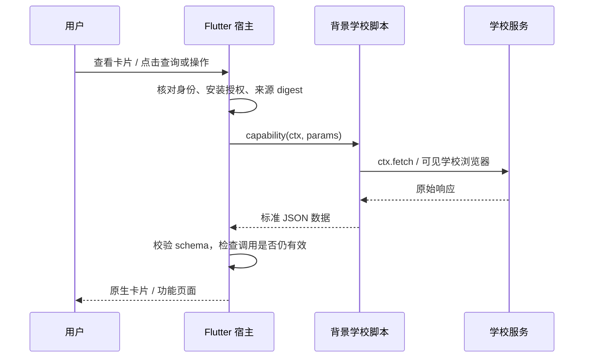

# elecon 开发 Wiki

这是学校脚本作者的统一入口：使用普通 ES 模块与异步函数编写学校协议，只为宿主调用的函数声明能力。先选择运行接口，再按需要接入原生展示、网页与账号。内部工具函数和学校步骤无需新增能力或专有流程语法。

**核对基线：2026-11-04 当前工作区，宿主识别 SDK1–17。** SDK17 提供标准形状的 Web API 子集和 `elecon` 宿主命名空间，旧示例的 `ctx` 继续可用；详细范围见[SDK 手册](sdk-and-host.md#sdk17普通-js-与宿主命名空间)。代码存在不代表客户端已发布或全部平台已验收，当前状态只维护在[统一实施计划](../planning/implementation.md)。

## 从这里开始

| 你要做什么 | 阅读入口 |
|---|---|
| 运行 API、SDK17 迁移、请求复制与取消 | [SDK 与宿主组件](sdk-and-host.md) |
| 首次开发、普通多文件模块、构建与类型检查 | [快速开始](quick-start.md) |
| 通知、课表、成绩、借阅、校园卡、考试、空教室、水电、空调、通用信息 | [卡片模板目录与代码](cards.md) |
| 登录入口、状态检查、保存密码、Cookie 和 Token | [登录与凭据](accounts.md) |
| 调用生命周期、计时器、原生输入、按钮与控制 | [交互与按钮响应](interactions.md) |
| 官方网页登录、DOM 读写、HTML 解析、包内网页 | [WebView 与 DOM](browser.md) |
| HTTP、国际化及 Flutter 组件调用 | [SDK 与宿主组件](sdk-and-host.md) |
| 稳定错误分类、恢复边界、验证与交付 | [调试与交付](debugging.md) |

## “组件”在本项目中的含义

| 概念 | 编写位置 | 例子 |
|---|---|---|
| 模板 | Flutter 宿主 | 课表网格、成绩列表、查询条件、前台请求按钮 |
| 能力（capability） | 学校脚本导出的函数 | `capabilities["grades.list"](ctx, params)` |
| 标准数据 | 契约定义，脚本归一化 | `term`、课程成绩、整数金额、来源时间 |
| 卡片实例 | `manifest.cards` | `{id:"academic-grades",type:"grades",…}` |
| 查询缓存策略 | `manifest.home` | 能力、参数、TTL、是否预加载 |
| 账号入口 | `manifest.accounts` | 登录说明、同包 login/status 绑定 |

脚本负责学校协议、认证和数据转换；宿主负责页面、路由、交互、身份、授权、取消和资源预算。`cards` 不接收 Widget tree、`onClick` 函数或任意路由。安装源码时用户批准的是内容 digest；更新代码、HTML 或翻译都需要提升包版本并重新确认。

## 阅读约定

- **完整示例**可按所给路径打包。[离线入门示例](examples/hello/manifest.json)只使用合成数据，无需学校账号或网络。
- **manifest 片段**需要合入现有 manifest；列出的能力还必须在源码中实现。
- **处理器示例**展示标准返回形状；学校服务地址、字段、ID 和认证规则需要按实际协议适配。
- **流程骨架**会明确指出需要作者实现的函数，不作为可直接运行的学校接入。

Wiki 是教程入口，实际字段以[源码包 schema](../../contract/script-package.schema.json)、[SDK 类型](../../contract/script-sdk/types.d.ts)、[能力注册表](../../contract/capability/registry.json)和[领域 schema](../../contract/schema/)为准。SDK 版本、包版本、业务 schema 版本各自独立。

修改宿主前读 [AGENTS](../../AGENTS.md)与[当前架构](../architecture.md)；不要求作者逐篇阅读 ADR。通用页面注册、匿名增强权限、公共业务中继、隐藏远端认证和 WebView APPTunnel 的未实现部分，不应写入现有包冒充可用接口。V1 继续按[兼容边界](../reference/legacy_compatibility.md)维护。
